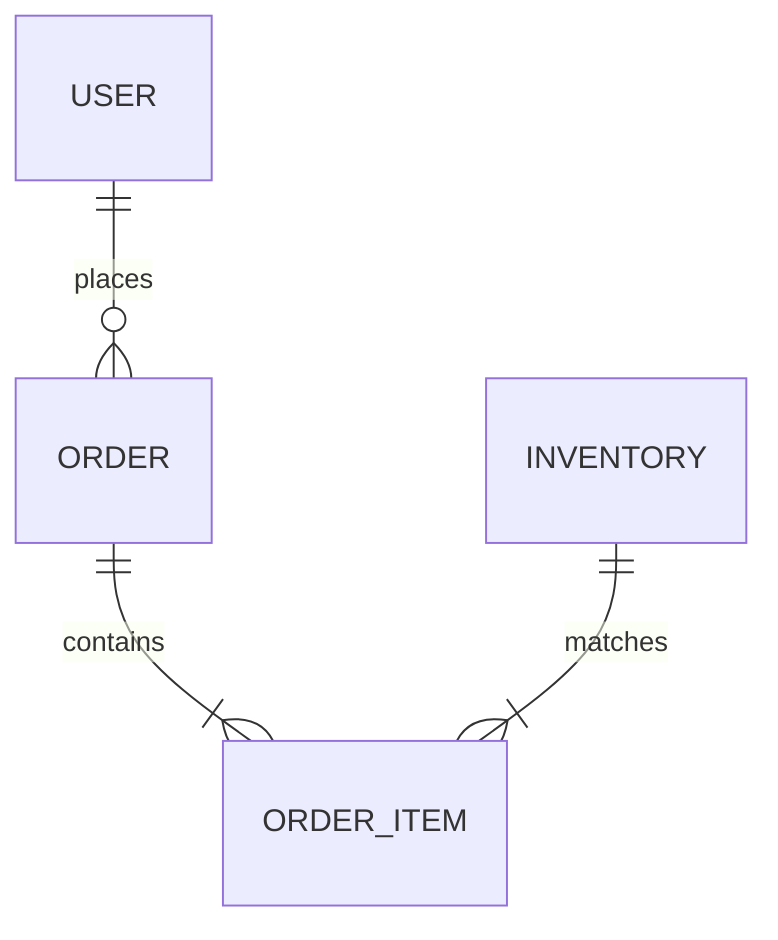

# Specification: Inventory & Order Management API

## 1. Намір
Створити ізольовані модулі для управління залишками товарів та замовленнями з транзакційною консистентністю.

## 2. Модулі та Залежності
| Модуль | Відповідальність | Залежності |
|---|---|---|
| Inventory | Управління залишками | Немає |
| Users | Користувачі | Немає |
| Orders | Оформлення замовлень | Users, Inventory |

## 3. Дані та зв'язки (ER)

## 4. Сценарій (Оформлення замовлення)

- Клієнт відправляє POST /orders.
- Модуль Orders перевіряє користувача.
- Модуль Orders звертається до Inventory для списання.
- Збереження замовлення в БД в транзакції.