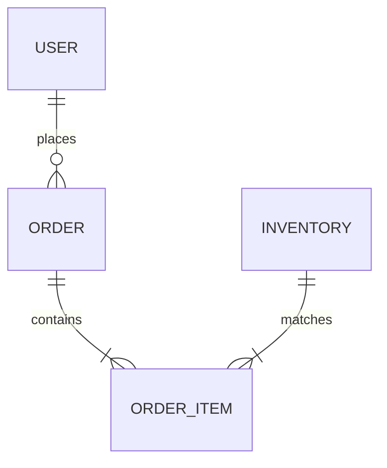

# Specification: Inventory & Order Management API

## 1. Намір
Створити ізольовані модулі для управління залишками товарів та замовленнями з транзакційною консистентністю.

## 2. Модулі та Залежності
| Модуль | Відповідальність | Залежності |
|---|---|---|
| Inventory | Управління залишками | Немає |
| Orders | Оформлення замовлень | Inventory (Service) |
| Auth/Users| Аутентифікація | Немає |

*Аудит залежностей:* У першій версії `Orders` залежав від `Users`. Це неправильна залежність. `Orders` має покладатися на абстрактний `userId`, отриманий з токена, а не напряму імпортувати `UsersService`. Це виправлено в поточній архітектурі.

## 3. Дані та зв'язки (ER)

## 4. Сценарій (Оформлення замовлення)

-    Клієнт відправляє POST /orders.

-    Middleware валідує JWT (ідентифікація клієнта).

-    OrdersService звертається до InventoryService для перевірки/списання.

-    Збереження замовлення в БД (prisma.$transaction).

## 5. Критерії прийняття (Acceptance Criteria)

-    Транзакція скасовується, якщо товару недостатньо.

-   Модулі ізольовані: Orders не викликає БД Inventory напряму.

-   Усі HTTP-маршрути захищені від необроблених помилок (глобальний Error Handler).